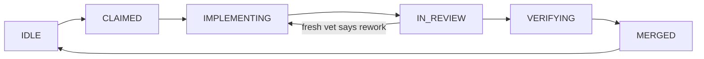

# Agent Harness Architecture — in plain language

**A GENERAL architecture document. It is about no specific project, product, or app.**
It describes a reusable way to run autonomous agent work so it survives, gets checked,
and improves — and it can be applied to any project: a web app, a library, a data
pipeline, a documentation set, or any other multi-step build. The projects that first
used this shape are not the subject here, and they are not named in this repo.
Where an example is needed, it is a clearly-labelled generic example, invented to
illustrate the pattern — not a report about a real project.

**Documentation only. No app code lives here.**

## The problem, in one sentence

An AI agent left alone will die quietly, praise its own broken work,
and forget everything when its context ends — so this architecture
puts the agent inside a cage that notices death, checks work, and
remembers.

## The two halves

| Half | Plain meaning | Where to read it |
|---|---|---|
| **Graph engineering** | The SHAPE of the work: what step comes next, who does it, what counts as done | [docs/01-graph-engineering.md](docs/01-graph-engineering.md) |
| **Harness engineering** | The SURVIVAL of the work: how a death is noticed, how work is checked, how the system learns | [docs/02-harness-engineering.md](docs/02-harness-engineering.md) |

A graph without a harness is a flowchart that fails at step two.
A harness without a graph is checks with nothing to check.

## The one picture

- The **control plane** (a small deterministic program, not an agent)
  owns those states. The agent only does the work inside one state.
- A **fresh vet agent** — never the builder — reads the real diff
  and writes `verdict: ship | ship-with-nits | rework`.
- Only after a ship verdict does `verify` print a real pass.
  Without a vet file, it prints `CHECKS PASS (vet pending)` — and
  that is not a merge.
- The parent (the human's main agent) owns merges, pushes, browser
  checks, and deploys. Workers propose; they never merge.

That loop is the whole system. Everything else in this repo is a
detail of one of those boxes or arrows.

## How to read this repo (5 minutes, in order)

1. [01 — Graph engineering](docs/01-graph-engineering.md): nodes,
   states, gates, the ratchet.
2. [02 — Harness engineering](docs/02-harness-engineering.md):
   heartbeat, sensors, verification, recovery.
3. [03 — Self-improvement](docs/03-self-improvement.md): how
   failures turn into permanent fixes, and how a selection loop
   picks the next feature.
4. [04 — Where it lives](docs/04-where-it-lives.md): one generic
   table mapping every concept to where it lives in a typical
   forge, with its status.
5. [05 — Decisions](docs/05-decisions.md): when to run things in
   parallel, when the loop stops, when a verdict blocks.
6. [Glossary](docs/glossary.md): every jargon term, in plain words.

Diagrams are in [diagrams/](diagrams/). Each one exists both as a
Mermaid block inside the relevant doc (GitHub renders it) and as a
standalone SVG file. Each diagram's caption says what it does
**not** show — read that before trusting it.

## What is a pattern, what is planned, what is parent-owned

Status words in this repo mean exactly this, for the pattern itself:

| Status | Meaning |
|---|---|
| Live pattern | The pattern is fully specified in this doc and ready to implement as written. It is not a claim that any particular project runs it today. |
| Planned | Written here as future work, not yet part of the core pattern. Do not cite it as a capability. |
| Parent-owned gate | A human (the parent agent) does it; no worker claim counts. |

| Claim | Status |
|---|---|
| Deterministic control plane with a state machine and a completed list | Live pattern |
| Quiescent loop: one run drains all ready actions until WAIT/NOOP | Live pattern |
| Weekly harness retro (one structural control per failure) | Live pattern (schedule is a project choice, e.g. weekly) |
| Selection loop: select → build → vet → reward, with bandit-style scoring | Live pattern (optional; a project may use a fixed priority list instead) |
| Parent browser click-through gate | Parent-owned gate, never a worker claim |
| Real-device gate (install on a real phone, offline reload after kill) | Parent-owned gate, separate from the web/browser gate |
| Parallel-track list implemented inside the control plane | Planned — until it exists, the parent is the sole writer of parallel-track state |

## What this repo is not

- Not a product, not a service, not a Google product. The wording
  "harness-2 / self-improvement" is mapped in
  [docs/03](docs/03-self-improvement.md) to the loops that
  actually exist in the architecture sources. No Google
  self-improvement system appears in any source read for this
  repo, and none is claimed here. If such a system exists
  elsewhere, it is not documented here, and filling that gap
  with an invented system would be exactly the kind of polished
  output hiding broken substance that the harness is built to
  reject.
- Not a promise that workers never die. The promise is narrower
  and checkable: a death is detected, resumed from crumbs, and
  turned into a structural fix so that exact death cannot recur
  silently.
- Not a document about any one project. It contains no app code,
  no app data, no fixtures, and no private information about
  any person (the word used here is "tester").

## Sources (architecture, not apps)

- The graph-engineering skill notes: the SHAPE (nodes, routing,
  parallelism, state, gates, ratchet).
- The harness-engineering skill notes: the SURVIVAL (guides,
  sensors, verification, recovery, generator ≠ evaluator,
  verify the artifact, leave crumbs, mistake → structural fix).
- Influences named in the harness skill (not quoted here, and
  not presented as verbatim claims): Hashimoto, Böckeler,
  Anthropic, OpenAI, LangChain, Huntley, HumanLayer.
