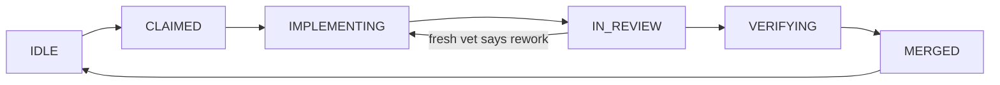

# Agent Harness Architecture — in plain language

**Documentation only. No app code lives here.**

## The problem, in one sentence

An AI agent left alone will die quietly, praise its own broken work,
and forget everything when its context ends — so this architecture
puts the agent inside a cage that notices death, checks work, and
remembers.

## The two halves

| Half | Plain meaning | Where to read it |
|---|---|---|
| **Graph engineering** | The SHAPE of the work: what step comes next, who does it, what counts as done | [docs/01-graph-engineering.md](docs/01-graph-engineering.md) |
| **Harness engineering** | The SURVIVAL of the work: how a death is noticed, how work is checked, how the system learns | [docs/02-harness-engineering.md](docs/02-harness-engineering.md) |

A graph without a harness is a flowchart that fails at step two.
A harness without a graph is checks with nothing to check.

## The one picture

- The **control plane** (a small deterministic program, not an agent)
  owns those states. The agent only does the work inside one state.
- A **fresh vet agent** — never the builder — reads the real diff
  and writes `verdict: ship | ship-with-nits | rework`.
- Only after a ship verdict does `verify` print a real pass.
  Without a vet file, it prints `CHECKS PASS (vet pending)` — and
  that is not a merge.
- The parent (the human's main agent) owns merges, pushes, browser
  checks, and deploys. Workers propose; they never merge.

That loop is the whole system. Everything else in this repo is a
detail of one of those boxes or arrows.

## How to read this repo (5 minutes, in order)

1. [01 — Graph engineering](docs/01-graph-engineering.md): nodes,
   states, gates, the ratchet.
2. [02 — Harness engineering](docs/02-harness-engineering.md):
   heartbeat, sensors, verification, recovery.
3. [03 — Self-improvement](docs/03-self-improvement.md): how
   failures turn into permanent fixes, and how the RL loop picks
   the next feature.
4. [04 — Where it lives](docs/04-where-it-lives.md): one table
   mapping every concept to the file that implements it, in the
   two real projects that use it.
5. [05 — Decisions](docs/05-decisions.md): when to run things in
   parallel, when the loop stops, when a verdict blocks.
6. [Glossary](docs/glossary.md): every jargon term, in plain words.

Diagrams are in [diagrams/](diagrams/). Each one exists both as a
Mermaid block inside the relevant doc (GitHub renders it) and as a
standalone SVG file. Each diagram's caption says what it does
**not** show — read that before trusting it.

## What is live, what is planned, what is parent-owned

| Claim | Status | Evidence |
|---|---|---|
| BJJ Forge v2 loop (5-min quiescent cron) | Live | BJJ harness `ARCHITECTURE.md` §6c |
| Flo Forge loop (parent-orchestrated, 2026-10-24) | Live, no cron yet | Flo harness `ARCHITECTURE.md` §6 |
| Weekly harness retro | BJJ: cron Sun 09:30. Flo: planned, not wired as a cron yet | BJJ §4; Flo §4 |
| Daily RL loop (select → build → vet → reward) | Live for BJJ | `AGENTS.md`, RL LOOP |
| Browser click-through | Parent-owned gate, never a worker claim | Flo §3, "Parent browser gate" |
| Real-phone install (iPhone Safari, Add to Home Screen) | Planned, later workstream | Flo §3, WS5 note |

## What this repo is not

- Not a product, not a service, not a Google product. The user
  wording "harness-2 / self-improvement" is mapped in
  [docs/03](docs/03-self-improvement.md) to the loops that
  actually exist in the sources. No Google self-improvement system
  appears in any source file read for this repo, and none is
  claimed here.
- Not a promise that workers never die. The promise is narrower
  and checkable: a death is detected, resumed from crumbs, and
  turned into a structural fix so that exact death cannot recur
  silently.
- Not a copy of Flo or BJJ app code. It documents the harness
  only, with file paths as references. No app data, no fixtures,
  no private information about any person (the word used here is
  "tester").

## Sources

- Graph skill: `custom-skills/local-graph-engineering/SKILL.md`
- Harness skill: `custom-skills/local-harness-engineering/SKILL.md`
- BJJ Forge v2: `goals/bjj-training-app-development/harness/ARCHITECTURE.md`
- Flo Forge: `goals/pcos-health-tracker-app/harness/ARCHITECTURE.md`
- Standing lessons: `AGENTS.md` (Flo Forge, Parallel subagents sections)
- Flo plan §§5–7: `goals/pcos-health-tracker-app/files/flo-dupe-plan-2026-10-24.md`

Influences named in the harness skill (not quoted here, and not
presented as verbatim claims): Hashimoto, Böckeler, Anthropic,
OpenAI, LangChain, Huntley, HumanLayer. The graph skill's verified
source is Karpathy's autoresearch repo README and the No Priors
"Loopy Era" episode; the skill itself flags that a viral
"Karpathy graph engineering" framing is misattributed marketing
and must not be repeated as his position.
