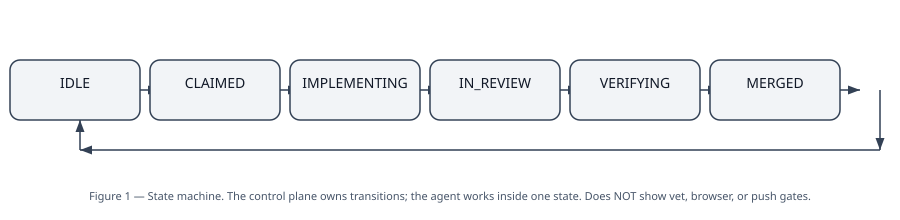
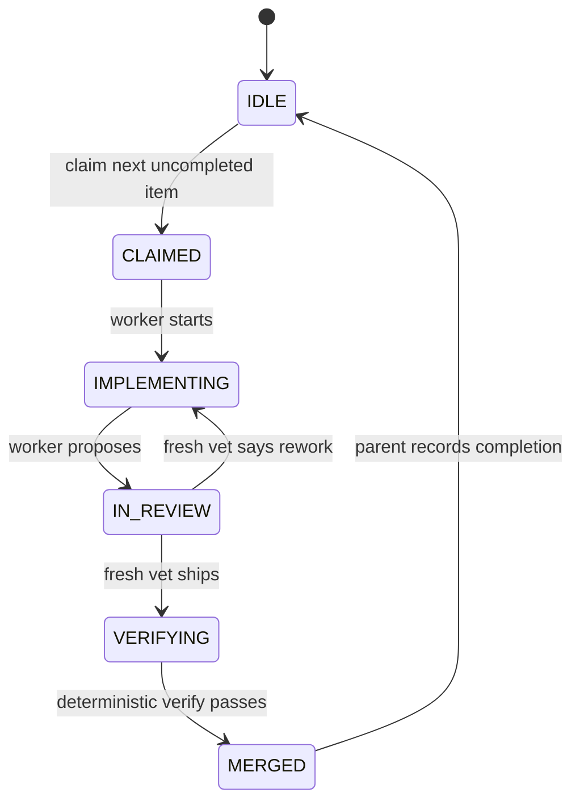

# 01 — Graph engineering: the SHAPE of the work

Plain version: before any agent touches anything, write down the
steps, who owns each step, and what "done" means — in code and in
markdown the agent can read. The agent then works inside that
shape. It does not get to redraw it.

## The shape, as a picture

**What this diagram does NOT show:** the vet, the browser gate,
or the push step. Those are gates *around* the states, drawn in
[02](02-harness-engineering.md) and in diagram 2. A state machine
alone does not verify anything.

## The words, in plain language

| Word | Plain meaning | If you skip it |
|---|---|---|
| **Node** | One step: a state like `IMPLEMENTING`, or a job like "build". | Work with no address. You cannot say where it died. |
| **Control plane** | A small deterministic program that owns transitions. It is not an agent and it cannot be talked out of its rules. | The agent rewrites the loop to declare itself done. |
| **State** | Where one item of work is right now. One item, one state, at a time. | Two workers on the same item, or an item lost between steps. |
| **Gate** | A check that must pass before the next state. A gate is not a report. | "Done" becomes an opinion. |
| **Macro action** | Delegate a whole feature, not a line of code. "Build the log screen", not "edit line 42". | Agents collide on the same file. |
| **Ratchet** | A rule that only allows forward movement that keeps the main branch good: always deployable, core features never regress. | A merge that breaks yesterday's working feature. |
| **Single scalar metric** | One number that says whether the work got better. No ambiguity about what "better" means. | Every worker optimises a different proxy. |

## The three-file contract

This is the oldest idea in the graph skill, and the one that
prevents most cheating:

| File | Who owns it | Agent may… |
|---|---|---|
| **Frozen** — rules of the game: state machine, priority list, prediction/privacy/safety rules | Human / parent | Read it. Never touch it. |
| **Mutable** — the one thing the agent changes: its branch, its progress note, its proposal | Worker | Change it, and only it. |
| **Org code** — markdown instructions: scope, heartbeat, stop conditions, how to fix a failure | Parent, iterated over time | Read it. Propose changes to it; never apply them alone. |

Why three files and not one? Because if the worker can edit the
rules, the scorer, and the work, then "done" is whatever the
worker says. Separating them makes gaming structural, not just
discouraged.

## Concept → where it lives

| Concept | Skill file | Forge file | Real example |
|---|---|---|---|
| Deterministic control plane | graph skill §1 | `forge.py` (BJJ), `flo-forge.py` (Flo) | One transition per run; BJJ quiescent loop drains ready actions, max 8, until WAIT/NOOP |
| States | graph skill §2 | `STATE.json` + control plane | `IDLE → CLAIMED → IMPLEMENTING → IN_REVIEW → VERIFYING → MERGED → IDLE` (both forges) |
| Completed-list sequencing | graph skill (routing) | Flo `flo-forge.py`: `next_uncompleted()`, `completed: []` | Flo vet M1: without it, `advance` re-claimed ws0 forever. Fixed, then proven by `test_forge.py` on a temp copy |
| Untrusted-proposer / trusted-verifier | graph skill §3 | Vet files `harness/vet/<ws>.md`, line 1 = verdict | Builder proposes; fresh vet cold-reads the diff, never the builder's summary |
| Markdown as coordination interface | graph skill §4 | `org-code/WORKER_BRIEF.md`, `FEATURE_CHECKLIST.md` | Briefs are written for agents: scope, heartbeat, stop conditions, remediation steps |
| Single scalar metric + ratchet | graph skill §5 | Build metric: verified checklist items merged/week (target ≥ 1) | A merge breaking log-save, export/delete, or adding a network call with health data is a revert, not a fix-forward |
| Macro actions + parallelism | graph skill §6 | One workstream per worker; parallel only on disjoint file sets | Flo §8; BJJ §6b parallel tracks (see docs/05) |
| Memory outside the context window | graph skill §7 | `STATE.json`, `JOURNAL.md`, `progress/<ws>.md`, `vet/<ws>.md` | "The agent forgets; the graph does not." A dead worker loses nothing the graph needs |

## The four preconditions for letting it run unattended

All four must hold. Missing any one, unattended operation is not honest:

1. **Verifiable outputs** — metrics and checks, not opinions.
2. **Reversible actions** — branches, reverts, local-first data the tester controls.
3. **Short feedback cycles** — a vet and a browser drive per workstream, not per quarter.
4. **Bounded action space** — one workstream, a brief's scope, nothing else.

Flo's tester deployment does **not** yet meet all four on its own:
it additionally needs the tester's explicit opt-in, which is a
human gate, not a harness gate. That is why deployment is
parent-owned even though building is autonomous.

## What the graph does not do

- It does not make a bad metric good. A loop amplifies its metric:
  a bad metric accelerates bad behaviour. (Graph skill, reliability ceiling.)
- It does not tolerate temporary regressions gracefully. The
  ratchet is strict by design; a "we'll fix it next merge" is a
  revert, not a plan.
- It does not replace human judgment. Metric specification,
  writing the org code, review depth, decomposition into
  non-interfering tasks, boundaries/safety, and the key insight
  itself never delegate. (Graph skill, "human judgment that never delegates".)
