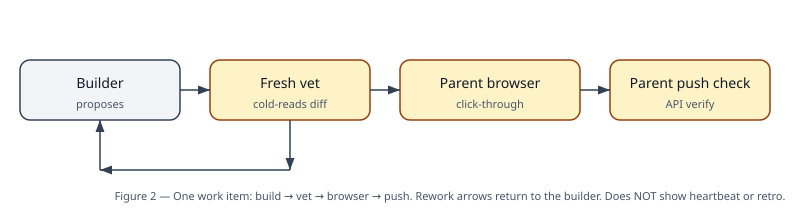
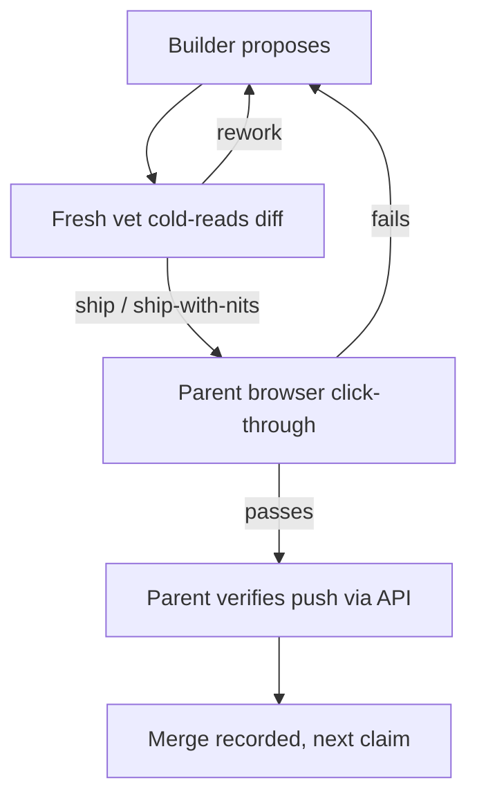
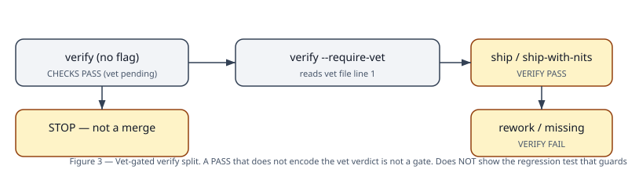
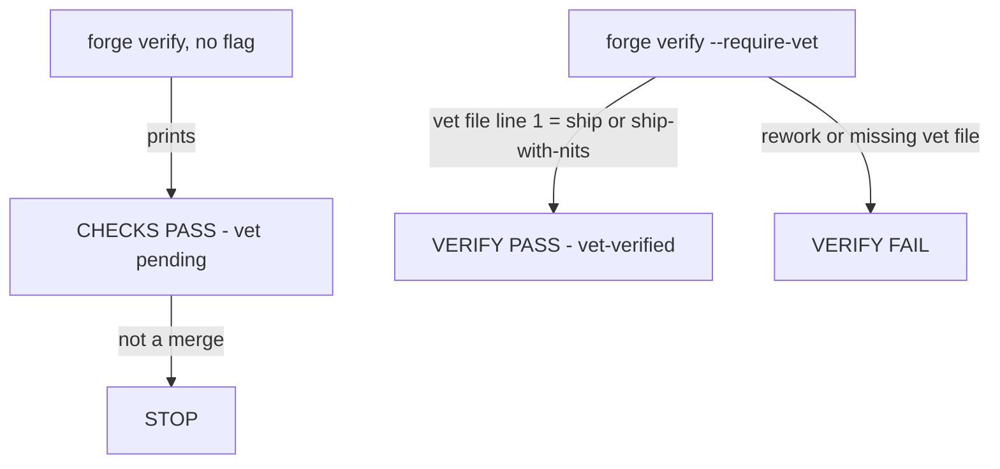

# 02 — Harness engineering: the SURVIVAL of the work

Plain version: the graph says what happens next. The harness is
everything that keeps that graph alive when the agent dies, lies
to itself, or loses the thread. Thesis, from the harness skill:
**Agent = Model + Harness.** Reliability is an environment
problem, not a model problem.

## The loop, as a picture

**What this diagram does NOT show:** the heartbeat that notices
a builder who never reaches the vet at all, or the retro that
learns from a failure. Those are in
[03](03-self-improvement.md). This picture is one work item's
happy path plus its two rejection arrows.

## The seven doctrines (short version)

| Doctrine | Plain meaning | How you check it |
|---|---|---|
| **Mistake → structural fix** | A recurring failure gets a permanent fix (a rule or a check), never just a retry. | The next run cannot make the same mistake the same way. |
| **Verify the artifact, not the report** | "Done" means the thing itself passes: the mail in Sent, the row re-read, the commit on the remote, the app driven as a user. | You re-read the artifact yourself. A handoff, a cron tick, or a "PASS" printout is a wake event, not evidence. |
| **Generator ≠ evaluator** | The builder never certifies its own work. A fresh agent re-reads it as a skeptic. | The vet file is written by a different agent, cold, with findings ordered blocker → major → nit. |
| **Guides + sensors** | Steer before acting (clear brief, remediation steps). Sense after acting (checks, validators, anomaly detection). | A failing check tells the worker *how* to fix itself, not just that it failed. |
| **Leave crumbs** | Timestamped logs, why-notes, decision records. Future sessions will not have this conversation in context. | Every artifact answers: what is done, what remains, how to run it, does it currently work. |
| **Session-start ritual** | Read memory, board, and goal state before acting. Pick up the actual current state. | The first act is a read, never an assumption. |
| **Re-derive per model release** | Every check encodes an assumption about a model's weakness. Assumptions go stale. | The retro asks: which scaffolding do we delete? Keep only what still prevents real failures. |

## Survival parts, each with a real failure behind it

### Heartbeat + supervisor

Every worker touches a heartbeat file at least every 10 minutes.
The control plane treats a heartbeat older than 45 minutes while
in `IMPLEMENTING` as wedged: terminate the attempt, resume a
fresh worker from the progress note and branch. Resume, never
restart from zero.

- **Failure that built it (BJJ, 2026-10-05):** a worker vanished
  with no heartbeat, no durable state, no supervisor, no resume,
  no learning. Nobody noticed for two days.
- **Failure that built the Discord version:** a bot died silently
  between checks; the fix was a supervisor process plus a
  heartbeat the watchdog could read, with crash-loop backoff.

### Foreground-only execution

Brief every worker: **never** start a background process. Run
everything in the foreground; a server test runs in one
foreground command that kills the server in the same command.

- **Failure that built it (SendShield, 2026-10-22, twice in one
  morning):** two builders died with "background exec disappeared
  before its result was delivered" when the runtime reaped the
  process. The repo on disk was healthy both times — no work was
  lost, but the loop halted. The agent is disposable; the work on
  disk is not.

### Vet-gated verify

**What this diagram does NOT show:** the regression test that
keeps this split honest. See below.

- **Failure that built it (Flo vet M5, 2026-10-24):** plain
  `verify` printed a bare `VERIFY PASS` without ever reading a
  vet verdict, so a future loop could merge on build + test
  alone. Fix: split the wording, and add a temp-copy regression
  test (`test_verify.py`, five paths: plain, ship, ship-with-nits,
  rework, missing) that never mutates real state. The next edit
  to `verify` cannot silently regress the gate — unless nobody
  runs the test, which is exactly what Flo vet Major 3 (WS1)
  caught: the test existed but was wired into no command. A test
  nobody runs decays like a check nobody reads.

### Parent browser gate

Generic subagents cannot operate a live browser: no clicking,
signing in, forms, or driving a preview as a user. So browser
click-through is a **parent-owned** gate with its own checklist
item and its own evidence file. A worker's headless run is
supporting evidence only; it never closes the gate. Real-phone
behaviour (iPhone Safari, Add to Home Screen, offline reload)
is a separate, later gate that a headless pass never implies.

- **Failure pattern (Flo, two vet rounds in a row):** both vets
  had to record "browser click-through NOT done" as a gap,
  because tests prove store logic, not rendered buttons.
- **WS0 gate, closed by the parent:** load synthetic days → save
  a hand day → calendar shows it → reload persists → export
  contains the hand day → delete-all → reload empty. Evidence
  file, not a claim.

### Privacy sensors (Flo's instance — sensors are app-specific)

Sensors, in priority order for a health app: heartbeat age,
build/test/check exits, privacy-check result, vet verdict on
file, remote tip + tree after push, browser-gate evidence on
file. The privacy check scans for network calls, analytics
SDKs, partner-sharing code, and banned claims.

- **Failure that built the line-scoped exemption (Flo vet M4):**
  a file-wide partner exemption would have let any future
  partner code in the same file sail through. Fix: a partner
  mention passes only on a line that itself contains the
  deferred-workstream note, plus a negative test (same-line
  passes, cross-line fails).
- **Documented limit, not hidden:** a keyword sensor is a
  tripwire, not a proof. Sharing code that never uses the word
  "partner" would pass it. The human vet remains the sharing
  gate; the sensor must never be cited as proof that no sharing
  code exists.

### Dual-store delete + synthetic labelling

- **Failure that built it (Flo vet M2 → Fix-Major 1):** delete
  wiped one store but not the other, and both-stores-failing
  still resolved as success while the UI said "deleted". Fix:
  wipe both stores best-effort each, throw only when both fail,
  and show "Delete failed — try again" with the confirm card
  left open. Delete is the one feature a user must trust
  absolutely; silent success is its exact forbidden failure mode.
- **Failure that built it (Flo vet M3):** hand-entered days were
  labelled synthetic, and empty exports counted as synthetic by
  vacuous truth. Fix: hand days are `synthetic: false`; the
  export flag is computed as "non-empty AND every day synthetic".
  Labelling is the only thing separating demo data from real
  data; a mislabelled export corrupts that boundary.

### GitHub push discipline

Push from a staging repo, never from the goal directory (which
is not a git repo). Seed an empty repo first (the empty-repo
409). Use `--from <newest local SHA> --base <remote full
40-char SHA>`; `--from` replays from that commit **onward**, so
pointing at an older commit replays everything after it, and a
second push for the same commit duplicates it. Never pipe the
push through `tail` (its exit code masks the script's failure).
After every push, verify via the API: private, default branch
still `main`, tip SHA + message + parent chain, tree clean (no
`node_modules`, no `dist`, no secrets, no real health data).
Never report repo state from a local clone — a clone with no
remote proves nothing except that it is disconnected.

## The three failure modes the harness is built against

From the harness skill (Anthropic's framing, as recorded there):

1. **Context** — sessions start with no memory; coherence drifts
   as the window fills. Fix: structured handoffs, crumbs, state
   files. Compaction is not coherence.
2. **Planning** — one-shot attempts, half-built features,
   premature victory on partial progress. Fix: one item per
   session, tests/build as backpressure.
3. **Self-judgment** — agents "confidently praise" mediocre work;
   polished output hiding broken substance. Fix: generator ≠
   evaluator, always.

## Backpressure, in one paragraph

Wire typecheck, lint, and tests so invalid output is rejected
automatically: success silent, failure verbose, and the failure
message tells the worker how to fix itself. If a check can be
ignored, it will be ignored at exactly the moment it matters.
