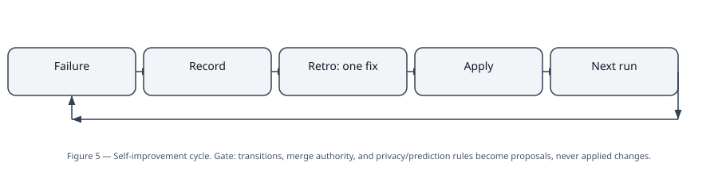
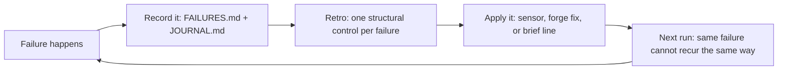
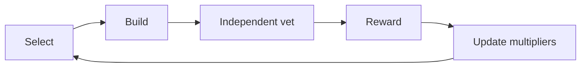

# 03 — Self-improvement: the part that compounds

Plain version: the harness does not just run work. It watches
its own failures and turns each one into a permanent fix, so the
same failure cannot happen the same way twice. That is the whole
self-improvement idea. Nothing mystical, no new model, no
product — just a loop with a memory.

## A note on the name first

The wording sometimes used for this page is "harness-2 / Google
self-improvement". Plain answer: **no Google product or Google
self-improvement system appears in any architecture source read
for this repo**, and none is claimed here. What the sources
actually contain, and what this page documents, is:

- the harness skill's **weekly retro** (self-improvement loop),
- **vet-loop compounding** (each vet round's majors become the
  next iteration's first tasks),
- a **selection loop** (select → build → vet → reward),
- worker process proposals triaged by the retro.

If a "Google self-improvement" system exists elsewhere, it is
not in these sources and it is not documented here. Filling that
gap with an invented system would be exactly the kind of
polished output hiding broken substance that the harness is
built to reject.

## The self-improvement cycle, as a picture

**What this diagram does NOT show:** the gate on the retro.
The retro may change sensors, brief text, and non-transition
code freely. Changes to state-machine transitions, merge/deploy
authority, prediction rules, or privacy rules become a **proposal
for the human**, never an applied change. The agent never
rewrites the control plane itself. Without that gate, "self-
improvement" is just the agent quietly loosening its own rules.

## Loop 1 — Vet-loop compounding (generic pattern)

Each vet round's majors become the **next iteration's first
tasks**, recorded as gates in the checklist before the next claim
is issued — not as a vague "address feedback" note.

| Vet round (generic example) | Majors (generic example) | Became |
|---|---|---|
| First vet (ship-with-nits) | Completed-list sequencing, dual-store delete, synthetic labelling, line-scoped sensor exemption, vet-gated verify | Fixes run, then fixes vet |
| Fixes vet (ship-with-nits) | Both-stores-failing delete; regression test for the vet gate; a default-date nit | Next work item's run |
| Next work item's vet (ship-with-nits) | Record the earlier item completed before any merge; edit + date-change must not duplicate; wire the regression test into a real command | Next run's first tasks (gates in checklist) |

Two rules inside this loop:

- **Ship-with-nits is not a merge.** State stays `IN_REVIEW`
  until the parent merges. It means "proposal accepted, gates
  recorded", never "deploy".
- **Nits are carried forward explicitly**, never dropped because
  a vet passed: a stale claim after `MERGED → IDLE`, `advance`
  printing `VERIFY` on a rework verdict, same-second journal
  bursts from a bootstrapping run (a one-time artefact, which
  must not repeat).

## Loop 2 — Weekly harness retro

| Step | What happens | Gate |
|---|---|---|
| Read | `FAILURES.md` + `JOURNAL.md` + worker proposals | — |
| Convert | Each failure → exactly one structural control: a new sensor, a forge fix, or a brief line | One control per failure, no more, no less |
| Record | The failure → fix mapping, dated | Future sessions can see why a rule exists |
| Apply or propose | Sensors, brief text, non-transition code: apply. Transitions, merge authority, permissions, prediction/privacy rules: propose to the human | The agent never rewrites its own cage |

- Cadence is a project choice; weekly is the usual pattern,
  reporting to the project chat.
- A retro that is planned but not yet wired as a scheduled job
  must be labelled **planned**, not live. Saying otherwise
  would be inventing a schedule.
- The retro also asks the re-derive question: which scaffolding
  still earns its keep? Delete checks that no longer prevent
  real failures.

## Loop 3 — Worker process proposals

Any worker may append a "what bit me / what would have helped"
note to `org-code/PROCESS_CHANGELOG.md`. The retro triages:
apply, adapt, or reject **with a reason**. Applied proposals are
dated and attributed. This is the cheapest loop in the system
and the one most often skipped — which is why it is written
into the brief rather than left to goodwill.

## Loop 4 — Selection loop (optional, daily pattern)

This is the loop that picks *what* to build next, not just how
to build it well. A project may use a fixed priority list
instead; the selection loop is optional, not required.

| Part | How it works |
|---|---|
| Select | Each feature scored by `user_value × feasibility × evidence × learned type_multiplier` (contextual-bandit style). One feature at a time. Never pick features a prior decision killed or parked. |
| Build | One feature, built by a worker. |
| Vet | Independent checker, fresh agent, every build. |
| Reward | ship = +1, ship-with-nits = +0.5, rework = −1. The human's chat feedback applies ±2. |
| Update | Multipliers update by exponential moving average, stored in the selection policy file. |

- Cadence is a project choice; daily is the usual pattern.
  Continuous building replaced debate panels as the decision
  mechanism in the pattern's history — a panel that was disabled
  must never be re-enabled without an explicit go-ahead.
- The selection loop does not override the vet gate or the
  merge gate. It picks the next feature; the vet still decides
  whether it ships.

## What self-improvement is not

| Claim | Truth in the sources |
|---|---|
| "The system improves itself with no human in the loop" | False. The retro's safety-gate changes are proposals. Merges, deploys, and tester gates are parent-owned. |
| "A Google self-improvement product runs this" | Not in any source. Not claimed. |
| "More loops = better" | False. Each loop needs a trusted verifier gate, or it amplifies its own metric — including a bad one. |
| "The retro deletes scaffolding freely" | Only scaffolding that no longer prevents real failures. The re-derive question is asked, not assumed. |

## The honest reliability sentence

Each additional nine of reliability costs as much as all
previous ones combined. This architecture does not promise a
worker won't die. It promises a death is detected within
minutes-to-hours (heartbeat), resumed from crumbs, and converted
into a structural fix — so that exact death can't recur
silently. The two places it deliberately refuses to accelerate
are the vet (fresh agent, cold read, every round) and the tester
gate (opt-in, parent browser drive, no deploy on a worker's
word). Those are not delays to optimise away; they are the
reason the loop is trustworthy enough to run unattended.
