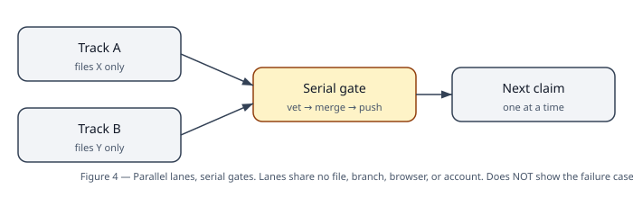
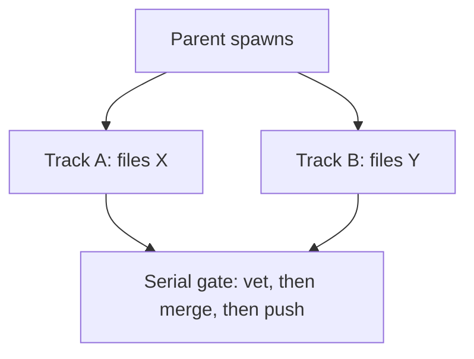

# 05 — Decisions: tables, not essays

Each table is a decision you will actually face while running
the loop. If your situation is not in a table, sequence it,
vet it, and let the retro add a row — do not improvise a gate
away.

## Decision 1 — Spawn in parallel, or sequence?

**What this diagram does NOT show:** the failure case. If
tracks A and B share a file, a branch, or a browser, they are
not two lanes — they are one lane with a race condition, and
the diagram is a lie. Check the sets before spawning, not
after a conflict.

| Question | If YES | If NO |
|---|---|---|
| Are the tasks truly independent? | Continue down | Sequence: the dependent task waits |
| Are file sets / branches / accounts / browsers disjoint? | Continue down | Sequence: shared state is single-lane by definition |
| Does neither task need the other's output to start? | Continue down | Sequence: a task consuming another track's diff/verdict/push tip is dependent |
| Is neither agent the evaluator of the other's work? | **Spawn in parallel, in one turn** | Sequence: build, then vet after build, then push/deploy serially |

If **any** answer is no, sequence. A dependent task spawned in
parallel is not faster — it is a rework waiting to happen.

**Never spawn in parallel, even if the four answers look yes:**

| Situation | Why |
|---|---|
| Two agents editing the same file | Collision is guaranteed, not possible |
| Two agents pushing/merging the same repo/branch | Duplicate commit or non-fast-forward |
| Two agents driving the same browser/preview | One session, one driver |
| Builder + vet on the same artifact at the same time | A vet cannot cold-read a moving diff; "ship" on a moving target is not a verdict |
| Interfering workstreams with no frozen interface | If the interface is not frozen first, sequence; if it is frozen, split the files, then parallelise |

**Briefing rules for a parallel agent** (a child does not
inherit the parent's transcript, so the brief must be
self-contained): outcome wanted; non-obvious constraints;
exact files it may touch; exact files it must NOT touch;
foreground-only exec; synthetic/test-data rules where relevant;
return format (files with paths, commands with outputs, what
it verified itself, what remains). A brief that assumes shared
context is a brief that will collide.

**Limits:** a coordinator's subagents cannot spawn further
subagents — split parallelism at the parent instead. Merges,
pushes, and deployments are serial, parent-owned gates, never
parallel, never decided by a worker. A track's failure is
reported with its files/lines, never hidden because other
tracks succeeded. A dead track resumes from its own crumbs
without restarting other tracks.

## Decision 2 — When does the loop stop?

| Situation | Stop? | Why |
|---|---|---|
| Routine decision (which order, which nit first, which wording) | **No** — keep going | The harness owns routine decisions; waiting on the human for them is the stall the loop exists to remove |
| A worker died / stalled | **No** — resume it | A stall is a harness bug with a resume plan, not a question for the human |
| Safety gate not yet passed (fresh vet missing, browser gate open, deploy on a worker's word) | **Yes** — stop at the gate | These are the reason the loop is trustworthy enough to run unattended |
| Genuinely user-only choice (a tester's own sharing consent, a tester's opt-in to test at all) | **Yes** — wait for that person | No agent can consent on someone else's behalf |
| A change to transitions, merge/deploy authority, prediction rules, or privacy rules | **Yes, as an applied change** — it becomes a proposal | The retro/agent may propose; only the human applies it |

## Decision 3 — What does a vet verdict mean?

| Verdict (line 1 of vet file) | Meaning | Next step |
|---|---|---|
| `verdict: ship` | Proposal accepted, no majors | Parent may move to verify/merge; browser gate still owed separately |
| `verdict: ship-with-nits` | Proposal accepted, **gates recorded** | Record every major as a checklist gate before the next claim; STATE stays `IN_REVIEW` until the parent merges; nits carried forward explicitly |
| `verdict: rework` | Proposal not accepted | Back to `IMPLEMENTING`; the vet's majors become the next iteration's first tasks; `verify --require-vet` prints `VERIFY FAIL` |
| No vet file | No verdict exists | `verify` without `--require-vet` prints only `CHECKS PASS (vet pending)`; that is **not** a merge, and must never be quoted as one |

## Decision 4 — Is the browser gate closed?

| Evidence | Gate closed? |
|---|---|
| Tests pass (unit, integration, store logic) | **No** — tests prove logic, not rendered buttons |
| Worker's own headless run passes | **No** — supporting evidence only |
| Parent drives the real built output in a real browser (headless shell counts for the web gate), step by step, with an evidence file | **Yes, for the web gate** |
| Parent drives it on a real phone (iPhone Safari, Add to Home Screen, offline reload after kill) | **Yes, for the phone gate** — a separate gate; a headless pass never implies it |
| No evidence file exists | **No** — a gate without evidence is a claim, not a gate |

## Decision 5 — Is a push landed?

| Evidence | Landed? |
|---|---|
| Worker says it pushed | **No** — a report is not an artifact |
| Local clone shows the commit | **No** — a clone with no remote proves nothing except that it is disconnected |
| Authenticated API shows: private, default branch `main`, tip SHA + message + parent chain match, tree clean (no `node_modules`, no `dist`, no secrets, no real data) | **Yes** |
| Push output was piped through `tail` and "looked fine" | **No** — the pipeline's exit code is `tail`'s, masking the script's real failure; capture output to a file and read its result JSON |
